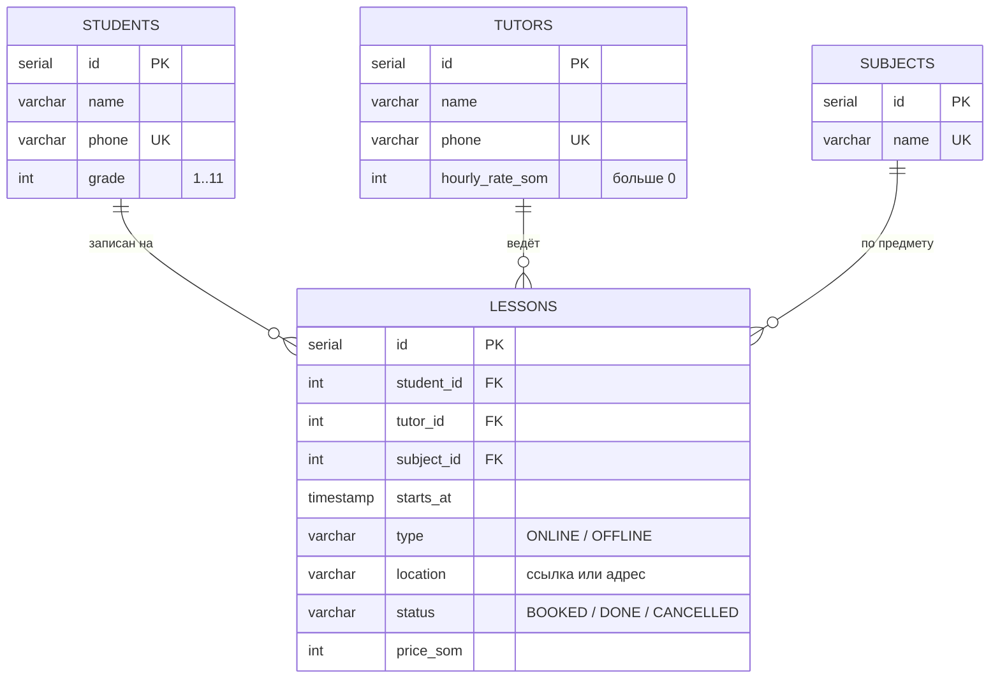
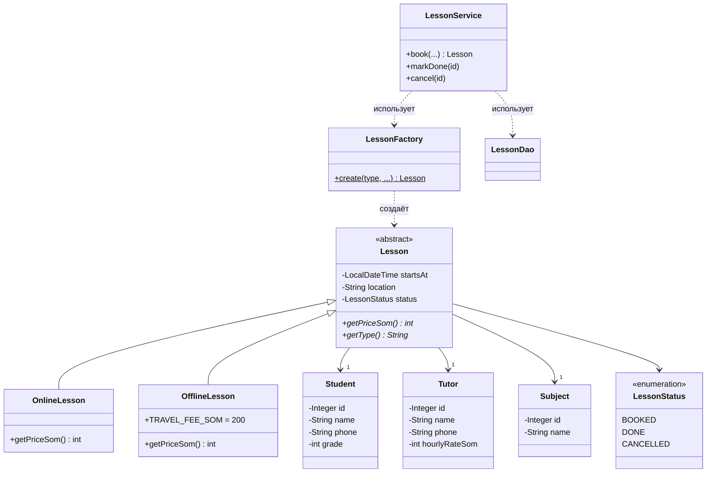

# Учебный центр — расписание

Панель администратора небольшого учебного центра: ученики, репетиторы, предметы,
запись на занятие с проверкой занятого времени, отметка «проведено / отменено»
и отчёт по репетиторам.

**Какую проблему решает.** Когда расписание ведётся в тетради, Excel или переписке,
случаются накладки (два занятия у одного репетитора в одно время), отменённые занятия
путаются с проведёнными, а зарплату репетиторам в конце месяца считают вручную.
Сайт не даёт записать на занятое время, хранит статус каждого занятия и одной страницей
показывает, сколько занятий провёл и заработал каждый репетитор.

Мидтерм по курсу **OOP and Databases**, Ala-Too International University, Fall 2026.
Автор: Айдай.

## Стек

| Часть | Инструмент |
|---|---|
| Язык | Java 21 |
| Веб | Spring Boot 4.1 + Thymeleaf (HTML-страницы) |
| База данных | PostgreSQL 17 |
| Доступ к базе | JDBC (`PreparedStatement`) в DAO-классах, без ORM |
| Сборка | Maven |
| Запуск | Docker + Docker Compose |

## Как запустить

Нужен только Docker.

```bash
cp .env.example .env          # затем впишите в .env пароли: DB_PASSWORD=... и ADMIN_PASSWORD=... (от 8 символов)
docker compose up -d --build  # собрать и запустить сайт + базу
```

Сайт: http://localhost:8080 (на сервере — `http://<IP сервера>:8080`).
Вход: логин `ADMIN_USERNAME` и пароль `ADMIN_PASSWORD` из файла `.env`.
Если их нет или пароль короче 8 символов, приложение не запустится и напишет, что исправить.

Остановить: `docker compose down` (данные сохраняются в томе `pgdata`).

Запуск без Docker для разработки: база всё равно в Docker (`docker compose up -d db`),
приложение — `./mvnw spring-boot:run`.

## Что умеет

- **Вход администратора** (Spring Security): без входа открыта только страница «Вход»;
  пароль хранится как хеш BCrypt, формы защищены CSRF-токеном, есть кнопка «Выйти».
- **Ученики, репетиторы, предметы** — добавить, посмотреть список, удалить (CRUD).
- **Запись на занятие** — онлайн или офлайн; цена считается автоматически.
- **Проверки при записи**: нельзя записать на прошедшее время; у репетитора и у ученика
  не может быть двух занятий, которые пересекаются (занятие длится 60 минут);
  отменённые занятия время не занимают.
- **Статусы**: «Запланировано» → «Проведено» или «Отменено».
- **Поиск** занятий по имени ученика.
- **Отчёт**: сколько занятий провёл каждый репетитор и сколько заработал (JOIN + COUNT + SUM).
- Нельзя удалить ученика, репетитора или предмет, у которых есть занятия — сайт объясняет почему.

## Схема базы данных (ER)



Таблицы в 3NF: у каждой сущности своя таблица, в `lessons` хранятся только ссылки (FK)
на ученика, репетитора и предмет, а не их имена.

Наследование в базе: в Java есть `OnlineLesson` и `OfflineLesson`, а в таблице наследования нет,
поэтому тип хранится в столбце `type`. При чтении `LessonFactory` по этому столбцу создаёт нужный класс.

DDL — [`src/main/resources/schema.sql`](src/main/resources/schema.sql).

## Схема классов (UML)



То же в PlantUML — [`docs/class-diagram.puml`](docs/class-diagram.puml).

## Слои приложения

```
Браузер → web/ (контроллеры) → service/ (правила) → dao/ (весь SQL) → PostgreSQL
                                      ↘ model/ (классы предметной области)
```

| Пакет | Что внутри |
|---|---|
| `model` | `Student`, `Tutor`, `Subject`, `Lesson` + наследники, `LessonStatus`, `LessonFactory` |
| `dao` | `StudentDao`, `TutorDao`, `SubjectDao`, `LessonDao` — только здесь есть SQL |
| `service` | `LessonService` — правила записи; `TimeSlotTakenException` |
| `web` | контроллеры страниц, `FormValues` — разбор чисел и дат из форм |
| `security` | `SecurityConfig` — какие страницы закрыты, страница входа, администратор из `.env` |

## Темы курса в проекте

| Тема | Где |
|---|---|
| Инкапсуляция, валидация в сеттерах | `Student`, `Tutor`, `Subject` — поля `private`, сеттеры бросают `IllegalArgumentException` |
| `equals` / `hashCode` | `Student`, `Tutor` — по телефону; `Subject` — по названию |
| Композиция | `Lesson` содержит `Student`, `Tutor`, `Subject` |
| Наследование, `abstract` | `Lesson` → `OnlineLesson`, `OfflineLesson` |
| Полиморфизм | `getPriceSom()` — онлайн = ставка, офлайн = ставка + 200 сом |
| `enum` | `LessonStatus` |
| Своё исключение | `TimeSlotTakenException`, `DatabaseException` |
| Коллекции | `List<...>` во всех DAO |
| SRP | модель / DAO / сервис / контроллер — у каждого слоя одна обязанность |
| Simple Factory | `LessonFactory` |
| DDL, ограничения | `schema.sql`: `PRIMARY KEY`, `FOREIGN KEY`, `UNIQUE`, `CHECK`, `NOT NULL` |
| JOIN | `LessonDao.findAll` — 4 таблицы; `tutorReport` — `LEFT JOIN` |
| Агрегаты | `COUNT`, `SUM`, `GROUP BY` в отчёте |
| JDBC, защита от SQL injection | только `PreparedStatement` с `?` |

## Оформление

- Шрифты **IBM Plex Sans** и **IBM Plex Mono** — Google Fonts, лицензия SIL Open Font License.
  Без интернета сайт переключается на системный шрифт, всё остальное работает.
- Иконки (поиск, меню, карточки сводки) — **Lucide** (lucide-static 0.469.0), лицензия ISC.
- Раскладка рабочего инструмента: меню слева со счётчиками, плотный список, форма за кнопкой «Новая…».
- Карточки сводки на странице занятий считаются одним SQL-запросом с `COUNT`, `SUM` и `CASE WHEN`
  (`LessonDao.summary`): занятий сегодня, проведено, выручка по проведённым занятиям.

## Ограничения (что сознательно не сделано)

- Один администратор, ролей нет; сменить пароль можно только в `.env` (и перезапустить).
- Нет ограничения числа попыток входа и нет HTTPS: для долгой работы в интернете
  нужны ещё лимит попыток и сертификат.
- Редактирования записей нет — только добавить и удалить.
- Две записи на одно время, отправленные в одну и ту же секунду, теоретически могут пройти обе
  (проверка и вставка — два отдельных запроса, без транзакции).
- Автотестов нет; проверено вручную по сценариям выше.
